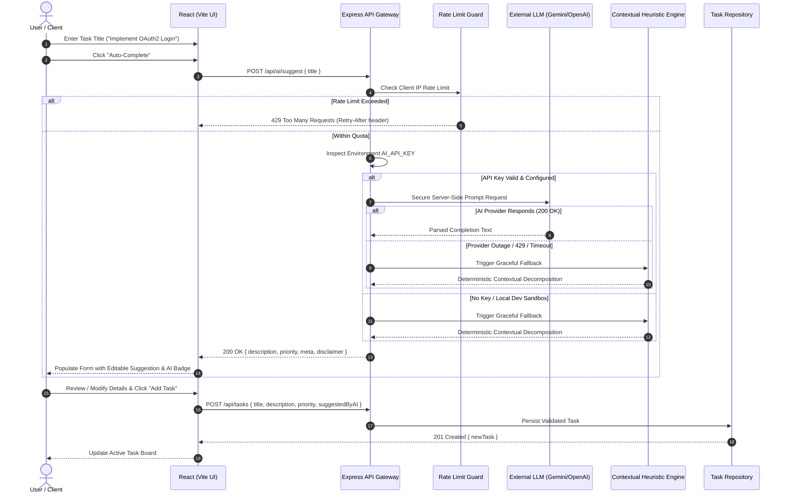

# Practical 13: Integrating an AI-Augmented Assistant into a Web Application

**Course:** ITUE301 - Advanced Web Development Frameworks  

---

## 1. Overview & Objective

Modern web engineering increasingly relies on Large Language Model (LLM) APIs to accelerate repetitive user workflows, automate structured drafting, and provide contextual recommendations.

This practical implements an **AI-Augmented Task & Sprint Management System** built with **Express.js** and **React (Vite)**. It demonstrates production-grade architectural patterns for integrating third-party AI APIs (Google Gemini / OpenAI), including:
1. **Zero Frontend Secret Exposure:** AI credentials and provider endpoints are strictly encapsulated within backend services.
2. **Rate Limiting & Abuse Prevention:** Sliding-window per-client IP throttling prevents API quota exhaustion and denial-of-wallet attacks.
3. **Graceful Degradation Engine:** When external AI APIs experience outages, network timeouts, or missing API keys, the system transparently falls back to an intelligent contextual heuristic engine. The end-user experience remains uninterrupted.
4. **Human-in-the-Loop AI Review:** AI-suggested fields (task breakdown, criteria, priority) are presented with clear transparency disclaimers and remain fully editable before persistent storage.

---

## 2. System Architecture & Request Flow



---

## 3. Directory Structure

```text
prc13/
├── backend/
│   ├── routes/
│   │   ├── aiRoutes.js         # Rate-limited AI proxy with graceful degradation
│   │   └── taskRoutes.js       # In-memory Task CRUD endpoints
│   ├── .env                    # Local environment variables
│   ├── .env.example            # Environment configuration template
│   ├── .gitignore              # Git ignore configuration
│   ├── app.js                  # Express application root & middleware pipeline
│   └── package.json            # Backend dependencies
├── frontend/
│   ├── src/
│   │   ├── App.jsx             # Main interactive task board with AI suggestion flow
│   │   ├── App.css             # Glassmorphic component styles and badges
│   │   ├── index.css           # Design tokens, typography, and theme variables
│   │   └── main.jsx            # React root mount
│   ├── index.html              # HTML shell
│   ├── vite.config.js          # Vite config with backend proxy
│   ├── .gitignore              # Frontend Git ignore
│   └── package.json            # Frontend dependencies
└── README.md                   # Comprehensive practical documentation
```

---

## 4. Key Implementation Highlights

### 4.1 Secure Server-Side LLM Proxy (`aiRoutes.js`)
External AI calls are strictly initiated from the Express backend. The browser communicates exclusively with `/api/ai/suggest`. The secret `AI_API_KEY` is never transmitted to the client, preventing credential scraping from client-side JavaScript bundles.

### 4.2 In-Memory Sliding-Window Rate Limiting
A per-IP sliding window enforces a minimum cooldown period between subsequent AI requests. If a client triggers rapid requests, the server responds with `HTTP 429 Too Many Requests` containing the remaining seconds to wait.

### 4.3 Contextual Graceful Degradation Engine
External LLM APIs introduce latency, rate caps, and unpredictable downtime. Rather than failing with an unhandled exception or blank screen:
- If `AI_API_KEY` is missing or placeholder-only, the backend switches to the heuristic engine immediately.
- If the external API call rejects (network timeout, upstream error), the `catch` block intercepts the failure and generates domain-specific acceptance criteria and priority levels based on NLP keywords in the title (e.g., `auth`, `cache`, `docker`, `test`).

### 4.4 Human-in-the-Loop & Transparency
Every AI-assisted suggestion populates editable form inputs rather than committing directly to the database. An explicit disclaimer badge alerts the user:
> *"AI Generated Suggestion: Review and refine the details below before saving to your task repository."*

---

## 5. Answers to Conceptual Viva Questions

### Q1: Why must AI API calls be made from the backend rather than directly from the frontend?
* **Credential Protection (Zero Trust):** If an API key is placed in frontend code (even in `.env` files within Vite or React), it is bundled into plaintext client-side JavaScript (`bundle.js`). Any user can inspect network headers or search browser sources to extract the key, leading to financial loss, unauthorized quota exhaustion, and abuse.
* **Rate Limiting & Cost Governance:** Placing the proxy on the backend allows the application owner to enforce IP-based rate limiting, user quotas, and billing safeguards before requests ever reach paid upstream LLM endpoints.
* **Prompt Sanitization & Injection Defense:** A server-side proxy allows inspecting, validating, and escaping user inputs before concatenating them into system prompts, neutralizing prompt injection vectors.
* **Response Normalization & Schema Enforcement:** External LLMs output non-deterministic text. Backend middleware can parse, shape, validate, and sanitize the LLM response into strongly-typed JSON before passing it to the frontend.

### Q2: What is graceful degradation and why is it essential when integrating external AI services?
* **Definition:** Graceful degradation is an architectural resilience pattern where an application continues to provide core functionality at a reduced level of sophistication when an external subsystem fails, rather than collapsing completely.
* **Importance in AI Applications:**
  1. *High Failure Frequency:* Third-party LLMs frequently experience upstream latency spikes, transient network outages, and strict concurrency/rate limits (`HTTP 429`).
  2. *Single Point of Failure Elimination:* If a task manager crashes whenever an external AI API is unreachable, the core task creation feature becomes unusable.
  3. *Uninterrupted UX:* By falling back to deterministic heuristic rules or standard empty fields, the user can still create, edit, and organize tasks without hindrance.

### Q3: What are the privacy, data governance, and ethical implications of sending user task data to third-party LLMs?
* **Data Leakage & Confidentiality:** Task titles and descriptions often contain proprietary intellectual property, customer PII, unreleased feature names, internal server hostnames, or confidential business strategies.
* **Model Training & Retention Policies:** Free or default tiers of commercial LLM APIs may retain prompt data to train future models unless explicit zero-data-retention (ZDR) enterprise agreements are signed.
* **Compliance Violations:** Transmitting task data to third-party cloud infrastructure located in different jurisdictions can violate GDPR, HIPAA, or SOC2 data residency mandates without explicit user disclosure and consent.
* **Ethical Transparency & Attribution:** Users must always know when content was generated by machine intelligence to prevent misattribution, hallucinations, or over-reliance on unverified automated outputs.

---

## 6. How to Run Locally

### Prerequisites
- Node.js (v18.0.0 or higher)
- npm (v9.0.0 or higher)

### Step 1: Start the Backend Server
```bash
cd prc13/backend
npm install
npm start
```
* Backend runs at: `http://localhost:5000`
* Health check: `http://localhost:5000/api/health`
* *(Optional)* To use a live Gemini or OpenAI key, update `prc13/backend/.env` with your API key. If left blank, the application automatically uses the contextual fallback engine.

### Step 2: Start the Frontend Application
In a separate terminal window:
```bash
cd prc13/frontend
npm install
npm run dev
```
* Frontend runs at: `http://localhost:5173`
* Vite automatically proxies `/api` requests to `http://localhost:5000`.

### Step 3: Verify Functionality
1. Open `http://localhost:5173` in your browser.
2. Enter a task title: `Configure Redis write-through caching layer`.
3. Click **"Auto-Complete"**.
4. Observe the loading state and the automatically generated technical scope, acceptance criteria, and priority level.
5. Review or edit the suggested text.
6. Click **"Save to Backlog"** and verify that the task appears in the sprint board with the `Automated` tag.
